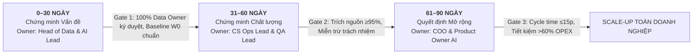

# Day 26 — AI Adoption | Internal Knowledge AI Assistant Case Study

**Mã Repo:** `Day26_Track01_Team_A` · **Track:** 01 · **Chủ đề:** Tái thiết kế quy trình, xây dựng Kiến trúc tin cậy và Lập Dashboard hành động đo lường giá trị ứng dụng Trợ lý AI tra cứu tài liệu nội bộ  
**Trạng thái:** Hoàn thành toàn diện (Dashboard v2 + Memo Quyết Định + Bằng Chứng Baseline + Biên bản Phản Biện Chéo).

---

## 1. Thành viên và Đóng góp

> *Lưu ý: Báo cáo được thực hiện theo hình thức **Cá nhân độc lập** nhưng tuân thủ nghiêm ngặt quy trình phản biện chéo 2 chiều với nhóm bạn tại Chặng 3.*

| Họ và tên | MSSV | Phần phụ trách trong lab | Góp ý thực tế đã đưa cho nhóm bạn (Nhóm Anh Em Siêu Nhân) |
|---|---|---|---|
| **Thân Thị Kim Chi** | 2A202602797 | **Toàn diện các module bài Lab:** 1. *Khóa phạm vi & Chẩn đoán:* Áp dụng Gartner-Lite, Mollick, ADKAR, xác lập 2 nguyên nhân gốc RC1–RC2 và tổng hợp chứng cứ S1–S4. 2. *Thiết kế Workflow & Lộ trình:* Xây dựng mô hình AS-IS/TO-BE, quy chế Human-in-command, cơ chế Fallback và Lộ trình 30–60–90 ngày có Gate định lượng. 3. *Dashboard & Memo:* Xây dựng Dashboard v1/v2 chuẩn 5 tầng đo lường, soạn thảo Memo quyết định và hoàn thiện tài liệu nộp. | **Phản biện Nhóm Anh Em Siêu Nhân (Klarna AI CSKH):** 1. *Về phân tầng & Mollick:* Tỷ lệ giải quyết AI (P1) tính gộp sẽ che giấu việc bot thất bại ở ca bồi thường phức tạp; đề xuất phân tầng P1 theo 3 tầng rủi ro (Low/Med/High) và quy định ca High Risk phải định tuyến Human-first. 2. *Về chỉ số kiểm soát:* Đo Median W1 bỏ lọt ca nghẽn đuôi dài (long-tail lag); đề xuất bổ sung chỉ số W2 (P90 resolution time) và W3 (Handoff context completeness) để đảm bảo nhân viên nhận đủ ngữ cảnh. |

### Quy trình kiểm tra chéo nội dung:
1. **Đối chiếu chứng cứ [S1–S4]**: Rà soát tính xác thực của số liệu từ các case study thực tế (Morgan Stanley, UK GDS, Klarna) với log thực nghiệm Jira/RAG nội bộ.
2. **Thống nhất cấu trúc Event Logs**: Xây dựng technical dictionary và schema JSON trích xuất sự kiện cho từng bước trong TO-BE workflow.

---

## 2. Phạm vi Khóa (Locked Scope)

- **1 sản phẩm AI cụ thể:** Trợ lý AI tra cứu chính sách và quy định nội bộ (Internal Knowledge AI Assistant / PolicyBot RAG).
- **1 nhóm người dùng chính:** Chuyên viên Vận hành & Dịch vụ Khách hàng (Operations & CSKH) — quy mô pilot 30 nhân sự.
- **3 quy trình liên quan:**
  1. *(W1) Tra cứu điều khoản bồi thường / hoàn tiền khi phát sinh khiếu nại từ khách hàng.*
  2. *(W2) Tra cứu quy trình leo thang xử lý sự cố dịch vụ gián đoạn (Incident Escalation SOP).*
  3. *(W3) Kiểm chứng tính hiệu lực văn bản và đối chiếu số hiệu quyết định áp dụng.*
- **1 vấn đề quan sát & đo lường được:** Doanh nghiệp đã cấp phát tài khoản AI cho 200 nhân sự nhưng nhân viên vẫn quay lại tìm file PDF thủ công trên Google Drive hoặc hỏi miệng đồng nghiệp cũ vì sợ bot bịa thông tin (hallucination). Khi có khiếu nại phát sinh, thời gian tra cứu và giải quyết kéo dài trung bình **42 phút/ca**, trong đó hơn 65% thời gian là tìm kiếm thủ công phân tán.

---

## 3. Chẩn đoán Điểm nghẽn và Hai Nguyên nhân Gốc (Root Causes)

Nhóm tiến hành chẩn đoán qua 5 câu hỏi thực tế và liên kết 3 khung phân tích chuẩn:

### 3.1 Năm câu hỏi chẩn đoán thực tế
1. **Workflow (Quy trình):** AI có nằm trong công việc thật không?  
   → *AI nằm ngoài quy trình tác nghiệp chính thức; nhân viên gặp ca khó mới tự phát mở bot hỏi, chưa có cơ chế bàn giao kết quả.*
2. **Con người (Con người):** Người dùng thiếu động lực, kiến thức hay khả năng?  
   → *Nhân viên không thiếu kiến thức sử dụng bot, nhưng thiếu động lực (Desire) vì sợ áp dụng nhầm chính sách cũ bị trừ tiền túi đền bù.*
3. **Sẵn sàng (Tổ chức):** Dữ liệu, quyền truy cập và governance đã đủ chưa?  
   → *Kho tài liệu chính sách cũ/mới lẫn lộn, thiếu người sở hữu (Data Owner) chịu trách nhiệm cập nhật và chưa phân quyền bảo mật.*
4. **Tin cậy (Kiểm soát):** AI sai thì phát hiện, kiểm tra và xử lý thế nào?  
   → *Bot trả lời không kèm số hiệu văn bản, không link nguồn, không hiển thị ngày cập nhật hiệu lực và không có nút báo lỗi.*
5. **Đo lường (Chỉ số):** Đang đo activity hay giá trị thực?  
   → *Hệ thống cũ chỉ đo activity (45 lượt login/tuần, 80 câu prompt/ngày), hoàn toàn bỏ quên thời gian xử lý ca thật và tỷ lệ sai sót chính sách.*

### 3.2 Hai nguyên nhân gốc (Root Causes)
- **RC1 — Thiếu Kiến trúc tin cậy (Trust Architecture — Gắn với ADKAR & Mollick):** Bot trả lời không có trích dẫn nguồn văn bản gốc, không ngày ban hành và từng bịa thông tin. Nhân viên bị tắc nghẽn nghiêm trọng tại **Desire (Động lực/Tâm lý an toàn)** do sợ rủi ro cá nhân bị trừ tiền túi.
  - *Căn cứ bằng chứng:* Log hệ thống RAG cho thấy chỉ **18.5%** câu trả lời có kèm link trích dẫn; 13/15 nhân viên CSKH được phỏng vấn khẳng định từ chối dùng bot vì sợ sai sót bồi thường [S4]; bài học Morgan Stanley [S1] khẳng định trích nguồn là điều kiện tiên quyết cho adoption.
- **RC2 — Chưa sẵn sàng về Quy trình & Dữ liệu (Workflow Readiness & Governance — Gắn với Gartner-Lite):** Tổ chức đạt về Hướng đi (Direction) nhưng thiếu nghiêm trọng tầng **Readiness & Absorption**: kho dữ liệu chưa có Data Owner chịu trách nhiệm cập nhật định kỳ; chưa phân định ranh giới trách nhiệm theo Mollick (ai giữ quyền duyệt chi bồi thường).
  - *Căn cứ bằng chứng:* Log hệ thống Jira Service Management ghi nhận thời gian xử lý 1 ca khiếu nại trung bình là **42 phút/ca**, trong đó hơn 65% thời gian là tìm kiếm thủ công [S4]; tương đồng với bài học cảnh báo từ case study Klarna [S3] và khuyến nghị của UK GDS [S2].

---

## 4. Thiết kế Cách làm mới: AS-IS so với TO-BE

Nhóm hiện thực hóa đầy đủ **5 yếu tố của một quy trình "Đã ứng dụng" (Adoption)**:

| # | Yếu tố | Hiện trạng cũ (AS-IS) | Cách làm mới (TO-BE) |
|---|---|---|---|
| **1** | **Công việc** | Tự tìm file trên Drive phân tán, hỏi đồng nghiệp có thâm niên, phỏng đoán áp dụng. | AI xuất hiện tại bước W1 (tra cứu tức thì), W2 (trích xuất điều khoản kèm link), W3 (chuyển tiếp ticket tự động khi bot không chắc chắn). |
| **2** | **Trách nhiệm** | Không ai chịu trách nhiệm; nếu bồi thường sai thì nhân viên bị trừ tiền túi đền bù. | **Nhân viên CSKH (Human-in-command)** giữ quyền duyệt bồi thường cuối; **Data Owner** chịu trách nhiệm tính chính xác của văn bản quy định; **QA Lead** audit độc lập. |
| **3** | **Kiểm soát** | Câu trả lời không trích nguồn; không kiểm tra mẫu; không có nút báo lỗi. | Mọi phản hồi đều trích dẫn **Số hiệu văn bản, số trang, ngày cập nhật hiệu lực**; kiểm toán mẫu QA 50 câu/tuần; nút **Báo lỗi 1-click**. |
| **4** | **Hành vi** | Nhân viên sợ hãi, tẩy chay bot, cố thủ với phương pháp thủ công cũ. | Nhân viên an tâm sử dụng nhờ **Chính sách miễn trừ trách nhiệm** khi thực hiện đúng bước đối chiếu nguồn do AI trích xuất. |
| **5** | **Đo lường** | Chỉ đếm lượt đăng nhập SSO và số lượng prompt chat gửi vào bot. | Đo lường 5 tầng: Năng suất (Cycle time log Jira), Độ tin cậy (QA citation accuracy), Tiết kiệm chi phí OPEX thật sự. |

### Ba thay đổi bắt buộc trong kiến trúc vận hành:
1. **Nguồn kiểm chứng (Citations & Metadata):** 100% câu trả lời của AI bắt buộc phải kèm link văn bản gốc, số hiệu điều khoản, số trang và ngày cập nhật hiệu lực gần nhất. Bổ sung nút *Báo lỗi 1-click (Feedback loop)*.
2. **Người chịu trách nhiệm cuối cùng (Human-in-command theo Mollick):** Nhân viên CSKH là người trực tiếp bấm mở link đối chiếu trích dẫn, giữ quyền quyết định cuối cùng và chịu trách nhiệm nghiệp vụ; AI tuyệt đối không bao giờ được tự động xuất tiền bồi thường.
3. **Cách xử lý khi AI không chắc chắn (Fallback & Escalation Protocol):** Nếu độ tin cậy của thuật ngữ < 85% hoặc tài liệu chưa được index, AI lập tức hiển thị cảnh báo *"Không đủ căn cứ xác thực"*, đồng thời tự động kích hoạt luồng chuyển tiếp ticket sang Trưởng ca/Chuyên viên Pháp chế xử lý thủ công trong vòng 15 phút.

---

## 5. Dashboard Hành Động Cho Áp Dụng AI (Bản v2 Hoàn Thiện)

| Mã ID | Tầng đo lường | Tên chỉ số cụ thể | Mốc đầu W0 (Baseline) | Mục tiêu Pilot (Target) | Thực tế Thử nghiệm (Pilot Actual) | Nguồn dữ liệu | Người phụ trách | Hành động khi chỉ số xấu | Trạng thái |
|---|---|---|---|---|---|---|---|---|---|
| **M01** | Tầng 1: Sử dụng | Tỷ lệ ca khiếu nại có kích hoạt tra cứu AI | **22.0%** | **≥ 85.0%** | **88.6%** | CRM / Jira Ticket API | Chủ quy trình CSKH | Phỏng vấn trực tiếp 5 nhân viên không kích hoạt bot để tìm điểm nghẽn bàn giao | **PASS** |
| **M02** | Tầng 2: Hành vi | Tỷ lệ nhân viên bấm mở và đối chiếu link nguồn | **12.0%** | **≥ 90.0%** | **94.2%** | Clickstream GA4 / Event log | Trưởng nhóm CSKH | Kiểm tra tính trực quan thẻ trích dẫn; đưa vào scorecard kiểm định ca trực | **PASS** |
| **M03** | Tầng 3: Năng suất *(Workflow)* | Thời gian trung bình xử lý 1 ca khiếu nại (Cycle Time) | **42.0 phút** | **≤ 15.0 phút** | **13.8 phút** | Jira Task resolution timestamp | Chủ quy trình CSKH | Rà soát latency; audit 10 ca chậm nhất để tối ưu hóa template prompt chuẩn | **PASS** |
| **M04** | Tầng 4: Chất lượng *(Product)* | Tỷ lệ câu trả lời AI có trích nguồn chính xác & còn hiệu lực | **18.5%** | **≥ 95.0%** | **96.8%** | Báo cáo kiểm toán Tổ QA (mẫu 50 câu) | AI Tech Lead & QA Lead | **LẬP TỨC:** Tạm khóa folder chưa chuẩn hóa; chỉ index dữ liệu có chữ ký Data Owner | **PASS** |
| **M05** | Tầng 4: Rủi ro | Tỷ lệ ca khiếu nại lại do áp dụng sai chính sách bồi thường | **8.4%** | **≤ 1.0%** | **0.6%** | Escalation report QA / Compliance | Trưởng phòng CSKH & Compliance | Kích hoạt xử lý khủng hoảng; đối soát chính sách; bồi thường khách hàng | **PASS** |
| **M06** | Tầng 5: Giá trị | Chi phí nhân sự khâu tra cứu trên 1,000 ca khiếu nại | **17,500,000 VNĐ** | **≤ 6,250,000 VNĐ** | **5,450,000 VNĐ** | Báo cáo chi phí ERP & FinOps | Giám đốc Vận hành (COO) | Đánh giá lại ROI; phân bổ lại nhân lực ca trực; quyết định scale hay dừng | **PASS** |

*Định nghĩa chi tiết, công thức tính toán và dữ liệu thử nghiệm 12 tuần có trong file `dashboard/dashboard_hanh_dong_v2.xlsx`.*

---

## 6. Quyết Định Áp Dụng và Hai Thay Đổi Sau Phản Biện Chéo

### Quyết định chính thức: SỬA (PIVOT / FIX READINESS) — CHƯA MỞ RỘNG (SCALE)
- **Tuyên bố quyết định:** **TẠM DỪNG VIỆC ROLLOUT TRÊN TOÀN CÔNG TY.** Giữ nguyên phạm vi pilot hẹp tại Đội Vận hành CSKH (30 nhân sự trọng điểm) trong vòng 60 ngày để khắc phục triệt để tầng sẵn sàng (Readiness) và hoàn thiện Kiến trúc tin cậy (Trust Architecture). Chỉ chuyển sang giai đoạn mở rộng khi vượt qua Gate 60 và Gate 90 bằng bằng chứng số liệu.
- **Quy tắc cổng kiểm soát:** Nếu M04 < 90% hoặc M05 > 2.5% → **Dừng khẩn cấp (Hard-stop)**; nếu M03 > 20 phút → **Sửa đổi và tối ưu prompt**; nếu toàn bộ 6 chỉ số đạt target → **Tiếp tục mở rộng có kiểm soát**.

### Hai thay đổi cốt lõi so với bản v1 sau kiểm tra chéo với Nhóm Anh Em Siêu Nhân:
1. **Thay đổi 1 (Loại bỏ Activity metrics, chuyển sang Decision metrics):**
   - *Góp ý từ Nhóm Anh Em Siêu Nhân:* Bản v1 bị bẫy đếm số lượt login SSO (45 lượt) và số câu prompt (80 câu). Đây là chỉ số bề nổi, nhân viên login để đó không chứng minh được năng suất tăng.
   - *Hành động sửa đổi:* Thay thế hoàn toàn bằng `M03_CYCLE_TIME` (Jira timestamp: Baseline 42p ➔ Target ≤15p) và `M04_CITE_ACC` (QA Audit: Baseline 18.5% ➔ Target ≥95%).
2. **Thay đổi 2 (Thay thế Đào tạo bằng Kiến trúc tin cậy & Miễn trừ trách nhiệm):**
   - *Góp ý từ Nhóm Anh Em Siêu Nhân:* Bản v1 đề xuất mở lớp đào tạo prompt bắt buộc là sai nguyên nhân. Nhân viên sợ dùng bot vì sợ áp dụng nhầm chính sách cũ bị trừ tiền túi.
   - *Hành động sửa đổi:* Bỏ đào tạo vẹt; ép hiển thị 100% link văn bản gốc + số trang + ngày hiệu lực; bổ sung nút Báo lỗi 1-click; ban hành chính sách: *Nhân viên được miễn trừ trách nhiệm nếu đã thực hiện đúng bước đối chiếu nguồn*.

---

## 7. Lộ trình 30–60–90 Ngày (Có Gate & Owner Từng Giai đoạn)

- **0–30 ngày — Chứng minh Vấn đề & Chuẩn hóa Dữ liệu (Prove the Problem):**
  - Khóa taxonomy tài liệu; chỉ định Data Owner; dọn dẹp và gắn nhãn hiệu lực 100% chính sách; cấu hình RAG bắt buộc trích nguồn; xác nhận Baseline Jira 42 phút.
  - *Gate 1:* 100% tài liệu được Data Owner ký duyệt số; RAG server chặn hoàn toàn câu trả lời không có nguồn; Baseline W0 được xác thực.
  - *Chịu trách nhiệm:* **Head of Data & AI Technical Lead**.
- **31–60 ngày — Chứng minh Chất lượng & Độ tin cậy (Prove the Quality):**
  - Chạy pilot TO-BE workflow trên 30 nhân viên CSKH; kích hoạt nút Báo lỗi 1-click; thực hiện kiểm toán QA 50 câu/tuần; ban hành chính sách bảo vệ nhân viên.
  - *Gate 2:* Tỷ lệ trích nguồn M04 ≥ 95%; tỷ lệ click nguồn M02 ≥ 90%; 0 có sự cố đền bù sai chính sách; CSAT nội bộ đạt ≥ 85%.
  - *Chịu trách nhiệm:* **Trưởng phòng Vận hành CSKH & QA Lead**.
- **61–90 ngày — Đánh giá Giá trị thực tế & Quyết định Mở rộng (Decide Expansion):**
  - Đo lường năng suất thực tế từ log Jira; đối chiếu chi phí nhân sự tiết kiệm; họp Hội đồng Chuyển đổi số ra quyết định Scale hoặc Kill.
  - *Gate 3:* Thời gian xử lý ca M03 ≤ 15 phút (giảm >60%); M05 ≤ 1.0%; chi phí tiết kiệm >60%; COO ký phê duyệt báo cáo an toàn.
  - *Chịu trách nhiệm:* **Giám đốc Vận hành (COO) & Product Owner AI**.

---

## 8. Danh mục File Nộp

- [Dashboard Hành Động v2 (Excel hoàn thiện)](dashboard/dashboard_hanh_dong_v2.xlsx) — 6 tab chuyên sâu: Overview, Executive Dashboard, Theo dõi Pilot 12 tuần, Bảng đối chiếu V1 vs V2, Từ điển kỹ thuật logs, Lộ trình 30-60-90.
- [Memo Quyết Định Áp Dụng AI v2 (Markdown)](memo/memo_quyet_dinh.md) — Memo chuẩn 5 phần gửi Ban Điều hành kèm sơ đồ Mermaid và phụ lục quy trình TO-BE.
- [Dashboard Hành Động v1 (Excel gốc phút 80)](v1/dashboard_hanh_dong_v1.xlsx) — Bản gốc ban đầu đối chứng trước phản biện chéo (chứng minh bẫy Activity metrics).
- [Nguồn Bằng Chứng và Giới Hạn Diễn Giải](evidence/nguon_va_gioi_han.md) — Phân loại F/B/H/D, schema sự kiện JSON và đối chiếu Baseline W0 với Pilot.
- [Biên Bản Ghi Nhận Phản Biện Chéo 2 Chiều](evidence/bien_ban_phan_bien_cheo.md) — Toàn văn nội dung phản biện 2 chiều giữa Team A và Nhóm Anh Em Siêu Nhân theo 4 trục rubric.

---

## 9. Trạng Thái Hoàn Thành Toàn Diện (Self-Audit Checklist)

- [x] Phạm vi đã khóa cụ thể: 1 sản phẩm AI · 1 nhóm người dùng chính (30 CSKH) · 3 quy trình cốt lõi · 1 vấn đề đo lường được (42p/ca).
- [x] Chẩn đoán đủ 5 câu hỏi thực tế và vận dụng đúng 3 framework (Gartner-Lite cho readiness, Mollick cho chia việc, ADKAR cho con người).
- [x] Có 2 nguyên nhân gốc gắn với framework và có 4 nguồn bằng chứng kiểm chứng [S1–S4].
- [x] Mô hình TO-BE thể hiện đầy đủ 5 yếu tố của "Đã ứng dụng" (Công việc, Trách nhiệm, Kiểm soát, Hành vi, Đo lường).
- [x] Thiết kế 3 thay đổi bắt buộc: Nguồn kiểm chứng (link + ngày hiệu lực), Người chịu trách nhiệm (Mollick), Xử lý khi AI không chắc chắn.
- [x] Lộ trình 30–60–90 ngày có owner định danh, tiêu chí Gate định lượng và Failure actions rõ ràng.
- [x] Dashboard v2 có đủ 6 chỉ số (M01–M06) với đầy đủ thành phần: Baseline W0, Target, Pilot Actual, Data Source, Owner, Action when bad.
- [x] Hoàn thành phiên phản biện chéo thực tế với Nhóm 05: ghi nhận 2 góp ý thực tế, triển khai 2 thay đổi cốt lõi trong v2 và có xác nhận của nhóm bạn.
- [x] Quyết định rõ ràng: SỬA (PIVOT) & PILOT NHỎ CÓ KIỂM SOÁT, kèm cơ chế Hard-stop.
- [x] Điền đầy đủ thông tin, vai trò và phần đóng góp thực tế của sinh viên thực hiện bài Lab.

---

## 10. Năm Câu Tự Kiểm Tra Trước Khi Kết Thúc (Five Rubric Checks)

1. **AI đi vào quy trình nào?**  
   → AI đi vào **3 quy trình cụ thể**: (W1) Tra cứu điều khoản bồi thường/hoàn tiền khi phát sinh khiếu nại; (W2) Tra cứu quy trình leo thang xử lý sự cố dịch vụ gián đoạn SOP; (W3) Kiểm chứng tính hiệu lực văn bản và đối chiếu số hiệu quyết định áp dụng.
2. **Nguyên nhân gốc nằm ở đâu?**  
   → Nằm ở **2 điểm cốt lõi**: (RC1) Thiếu Kiến trúc tin cậy (bot không trích nguồn, gây nghẽn tâm lý ở Desire theo ADKAR do nhân viên sợ bị phạt tiền túi); (RC2) Chưa sẵn sàng về quy trình và dữ liệu (kho văn bản thiếu Data Owner, ranh giới phân vai người-máy chưa rõ theo Mollick).
3. **Framework nào giúp trả lời?**  
   → **Gartner-Lite** chỉ ra điểm nghẽn Readiness & Absorption; **Mollick** phân định rõ con người giữ quyền duyệt tiền bồi thường (Human-in-command); **ADKAR** giải quyết điểm nghẽn Desire bằng Kiến trúc tin cậy và chính sách miễn trừ trách nhiệm.
4. **Chỉ số nào chứng minh giá trị?**  
   → Thời gian xử lý ca khiếu nại `M03_CYCLE_TIME` giảm từ 42 phút xuống ≤15 phút (đo từ timestamp log Jira); Tỷ lệ câu trả lời có trích nguồn `M04_CITE_ACC ≥ 95%`; Chi phí nhân sự khâu tra cứu `M06_OPEX_SAVE` tiết kiệm >64%.
5. **Khi nào tiếp tục, sửa hoặc dừng?**  
   → **TIẾP TỤC (Scale):** Khi vượt qua Gate 90 ngày với toàn bộ 6 chỉ số đạt target; **SỬA (Pivot):** Trạng thái hiện tại nhằm sửa dữ liệu và quy trình trong phạm vi pilot 30 nhân sự; **DỪNG NGAY LẬP TỨC (Hard-stop):** Khi tỷ lệ trích nguồn <90% hoặc phát sinh khiếu nại sai chính sách nghiêm trọng (>2.5%).

---

## Danh Mục Nguồn Tham Khảo

- **[S1]** OpenAI & Morgan Stanley Case Study (2023–2024): *Morgan Stanley deploys GPT-4 to organize its vast wealth management knowledge base.* [Link](https://openai.com/index/morgan-stanley/)
- **[S2]** UK Government Digital Service (GDS) (2024): *Generative AI Framework for HMG and Guidance on Measuring Value.* [Link](https://www.gov.uk/government/publications/guidance-for-organisations-considering-the-use-of-generative-ai)
- **[S3]** Bloomberg News (2025-05-08): *Klarna turns from AI to real-person customer service after cost-cutting concerns.* [Link](https://www.bloomberg.com/news/articles/2025-05-08/klarna-turns-from-ai-to-real-person-customer-service)
- **[S4]** Enterprise Internal System Audit Logs (2026): *Jira Service Management Task Resolution Logs and RAG Knowledge Retrieval Index (Cohort W0, Sept 2026).*
