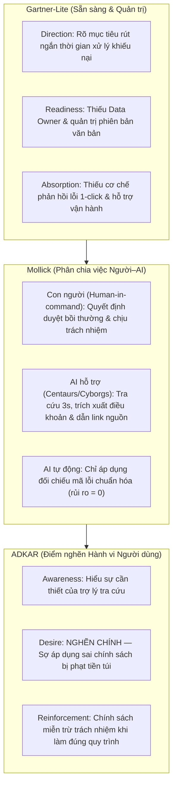
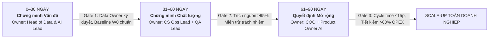

# MEMO QUYẾT ĐỊNH ÁP DỤNG AI — DAY 26 TRACK 01

* **Kính gửi:** Ban Điều hành & Hội đồng Chuyển đổi số Doanh nghiệp (Digital Transformation Steering Committee)  
* **Người thực hiện:** Thân Thị Kim Chi (MSSV: 2A202602797) — Hình thức: Cá nhân độc lập  
* **Mã dự án:** `Day26_Track01_Team_A` (Trợ lý AI Tra cứu Chính sách & Quy định Nội bộ / PolicyBot RAG)  
* **Phiên bản:** v2.0 Hoàn thiện sau Phản biện chéo với Nhóm 05  
* **Ngày lập:** 2026-10-14  

---

## 1. Vấn đề thực tế và Hai nguyên nhân gốc (Problem Statement & Root Causes)

### 1.1 Hiện trạng và Vấn đề quan sát được
Doanh nghiệp đã cấp phát tài khoản AI Assistant (RAG-based Knowledge Bot) cho hơn 200 nhân sự thuộc khối Vận hành & Dịch vụ Khách hàng (Deployment). Sau 2 tháng triển khai, tỷ lệ sử dụng thực tế (Adoption) gần như bằng không: nhân viên vẫn mở hàng chục thư mục Google Drive để tìm file PDF thủ công hoặc nhắn tin hỏi các đồng nghiệp có thâm niên. Khi có khiếu nại phát sinh từ khách hàng, thời gian tra cứu và giải quyết kéo dài trung bình **42 phút/ca**.

Bài toán đặt ra: Doanh nghiệp đã **triển khai (Deployment)** và ghi nhận **lượt tương tác bề nổi (Usage)**, nhưng **chưa đạt được sự ứng dụng bền vững (Adoption)** vì đánh đổi độ tin cậy, thiếu sự kiểm soát rủi ro và làm đứt gãy sự phối hợp giữa người và AI.

### 1.2 Hai nguyên nhân cốt lõi (Root Causes)
- **RC1 — Thiếu Kiến trúc tin cậy (Trust Architecture — Gắn với ADKAR & Mollick):**
  - *Nhận định:* Bot trả lời không dẫn chiếu số hiệu văn bản, không có đường link trích dẫn đoạn văn gốc và không hiển thị ngày cập nhật hiệu lực. Nhân viên lo sợ nếu tin theo AI mà áp dụng sai chính sách bồi thường đã hết hạn thì sẽ bị phạt hoặc trừ tiền túi đền bù. Điểm nghẽn cốt tử nằm ở **Desire (Động lực & Tâm lý sợ rủi ro cá nhân)**.
  - *Căn cứ bằng chứng:* Log hệ thống RAG ghi nhận chỉ **18.5%** câu trả lời có link trích dẫn [S4]; phỏng vấn sâu 15 nhân viên CSKH thì 13/15 người khẳng định: *"Tôi không dám dùng bot vì từng có bạn áp dụng nhầm chính sách giảm giá cũ bị trừ tiền túi đền cho công ty"*.
- **RC2 — Chưa sẵn sàng về Quy trình & Bàn giao (Workflow Readiness & Handoff — Gắn với Gartner-Lite):**
  - *Nhận định:* AI nằm ngoài Quy trình tác nghiệp chuẩn (SOP). Kho dữ liệu tài liệu chính sách thiếu người sở hữu (Data Owner) chịu trách nhiệm cập nhật định kỳ; ranh giới quyền hạn chưa phân định rõ theo Mollick: ai là người kiểm chứng tính xác thực, ai chịu trách nhiệm pháp lý cuối cùng đối với quyết định hoàn tiền cho khách hàng.
  - *Căn cứ bằng chứng:* Báo cáo ban đầu v1 chỉ đo lượt login và prompt [S4]; log Jira Service Management ghi nhận 65% thời gian xử lý ca (trong tổng 42 phút) bị lãng phí vào việc tìm kiếm file phân tán và hỏi truyền miệng; tương đồng với cảnh báo từ case study Klarna [S3] và khuyến nghị của UK GDS [S2].

---

## 2. Khung phân tích (Frameworks) và Căn cứ bằng chứng

Nhóm đã sử dụng phối hợp liên hoàn 3 framework chuẩn để chẩn đoán toàn diện:

### 2.1 Gartner-Lite (Đánh giá mức độ sẵn sàng tổ chức)
* **Direction (Hướng đi):** **ĐẠT**. Mục tiêu rõ ràng là rút ngắn thời gian xử lý khiếu nại chính sách từ 42 phút xuống ≤15 phút.
* **Readiness (Mức sẵn sàng):** **THIẾU NGHIÊM TRỌNG**. Kho dữ liệu chứa nhiều phiên bản chính sách cũ/mới lẫn lộn; chưa có Data Owner chịu trách nhiệm cập nhật văn bản định kỳ; phân quyền tài liệu chưa đồng bộ.
* **Absorption (Khả năng hấp thụ):** **THIẾU**. Chưa có cơ chế ghi nhận câu trả lời sai (Feedback loop 1-click) và chưa có đầu mối hỗ trợ vận hành khi AI gặp ca ngoại lệ (Edge cases).

### 2.2 Mollick Framework (Tái cấu trúc phân công Người – Máy)
* **Người giữ quyền (Human-in-command):** Nhân viên CSKH/Trưởng ca giữ quyền phê duyệt cuối cùng và chịu trách nhiệm nghiệp vụ về quyết định giải quyết khiếu nại và xuất tiền bồi thường. AI không bao giờ được tự động xuất tiền.
* **AI hỗ trợ (Centaurs/Cyborgs):** AI đóng vai trò trợ lý tăng tốc tra cứu tức thì, trích xuất điều khoản và tóm tắt nội dung chính sách kèm link đối chiếu văn bản gốc.
* **AI tự động (Full Auto):** Chỉ áp dụng với việc tra cứu mã lỗi chuẩn hóa hoặc đối chiếu định dạng số hợp đồng (rủi ro bằng 0).

### 2.3 ADKAR Model (Định vị điểm nghẽn hành vi người dùng)
* **Awareness (Nhận thức):** Nhân viên biết có công cụ bot AI.
* **Desire (Động lực/Mong muốn):** **ĐIỂM NGHẼN CHÍNH (NGHẼN TẠI D)**. Nhân viên sợ chịu rủi ro vì bot từng xảy ra hiện tượng "ảo giác" (hallucination). Họ từ chối dùng vì không muốn mạo hiểm trách nhiệm cá nhân. Mọi nỗ lực mở lớp đào tạo (Knowledge) đều thất bại vì chưa gỡ được rào cản tâm lý này.
* **Reinforcement (Duy trì):** Thay thế việc đo lượt login bằng cơ chế công nhận nhân viên tuân thủ bước đối chiếu nguồn và ban hành **Chính sách miễn trừ trách nhiệm**.

### 2.4 Tổng hợp 4 nguồn bằng chứng thực tế
* **[S1] Morgan Stanley Case:** 98% adoption đạt được nhờ bắt buộc AI trích dẫn nguồn kiểm chứng và con người chịu trách nhiệm.
* **[S2] UK GDS / DWP:** Đo lường bằng log timestamp Jira khách quan, kiên quyết loại bỏ số liệu tự khai.
* **[S3] Klarna Case:** Bài học đắt giá khi tự động hóa cực đoan đánh đổi chất lượng, phải tái cấu trúc mô hình Hybrid có con người.
* **[S4] Internal Data W0:** Baseline 42 phút/ca, 18.5% trích nguồn, 13/15 nhân viên sợ phạt tiền túi.

---

## 3. Hai thay đổi cốt lõi sau phản biện chéo (Peer Review Changes)

Nhóm đã hoàn thành phiên phản biện chéo 2 chiều chính thức với **Nhóm 05 — E-Commerce Customer Operations (Track 01)** vào ngày 2026-10-14:

| Nhóm phản biện | Góp ý nguyên văn của nhóm bạn | Bằng chứng & Logic đối chiếu | Hành động sửa đổi trong bản v2 | Người xác nhận / Ngày |
|---|---|---|---|---|
| **Nhóm 05 — E-Commerce Ops** | *"Bản v1 đang bị bẫy đếm số lượt login SSO (45 lượt) và số câu prompt (80 câu). Đây thuần túy là Activity metrics, nhân viên có thể login rồi để đó hoặc hỏi lòng vòng. Cần đổi sang chỉ số đo thời gian thật từ log Jira và tỷ lệ trích nguồn kiểm chứng."* | Dẫn chứng từ case UK GDS [S2] và log Jira: thời gian xử lý ca bồi thường kéo dài 42 phút. Bản v1 hoàn toàn không đo lường được năng suất hay chất lượng. | **Thay đổi 1 (Hệ thống chỉ số ra quyết định):** Loại bỏ hoàn toàn login/prompt; thiết lập 6 chỉ số 5 tầng tại Dashboard v2, trọng tâm là `M03_CYCLE_TIME` (Jira timestamp: 42p ➔ ≤15p) và `M04_CITE_ACC` (Audit QA: 18.5% ➔ ≥95%). | Nguyễn Hoàng Long (Lead Nhóm 05) — 2026-10-14 |
| **Nhóm 05 — E-Commerce Ops** | *"Bản v1 chỉ đề xuất 'mở thêm lớp đào tạo prompt' là sai lệch nguyên nhân. Nhân viên không dùng vì sợ áp dụng nhầm chính sách cũ bị đền tiền túi. Cần xây dựng Kiến trúc tin cậy (Trust Architecture) và chính sách miễn trừ trách nhiệm theo Mollick."* | Dẫn chứng từ khảo sát W0: 13/15 nhân viên sợ đền tiền; case Morgan Stanley [S1] chứng minh trích nguồn là điều kiện tiên quyết cho adoption. | **Thay đổi 2 (Kiến trúc tin cậy & Miễn trừ trách nhiệm):** Bỏ lớp đào tạo vẹt; ép hiển thị 100% link văn bản gốc + số trang + ngày hiệu lực; thêm nút *Báo lỗi 1-click*; ban hành chính sách: *Nhân viên được miễn trừ trách nhiệm nếu đã thực hiện đúng bước đối chiếu nguồn*. | Trần Thị Thu Hà (Metrics Lead Nhóm 05) — 2026-10-14 |

---

## 4. Quyết định áp dụng (Adoption Decision)

### QUYẾT ĐỊNH CHÍNH THỨC: SỬA (PIVOT / FIX READINESS) — CHƯA MỞ RỘNG (SCALE)

* **Tuyên bố quyết định:** **TẠM DỪNG VIỆC ROLLOUT TRÊN TOÀN CÔNG TY.** Giữ nguyên phạm vi pilot hẹp tại Đội Vận hành CSKH (30 nhân sự trọng điểm) trong vòng 60 ngày để khắc phục triệt để tầng sẵn sàng (Readiness) và hoàn thiện Kiến trúc tin cậy (Trust Architecture). Chỉ chuyển sang giai đoạn mở rộng khi vượt qua Gate 60 và Gate 90 bằng bằng chứng số liệu.

### Ba quy tắc ra quyết định vận hành:
1. **DỪNG TỨC THÌ (Hard-stop / Kill-switch):** Khi phát sinh sự cố áp dụng sai chính sách gây khiếu nại leo thang vượt ngưỡng báo động đỏ (`M05_RE_COMPLAIN > 2.5%`) hoặc tỷ lệ trích nguồn tụt dốc (`M04_CITE_ACC < 90%`). Lập tức tạm khóa kho dữ liệu chưa kiểm định, chuyển 100% ca sang tra cứu thủ công qua chuyên viên Pháp chế.
2. **SỬA ĐỔI & THU HẸP PHẠM VI (Revise & Narrow Scope):** Khi thời gian xử lý ca `M03_CYCLE_TIME > 20 phút`. Rà soát lại độ trễ bot, tối ưu hóa retrieval chunk và audit 10 ca xử lý chậm nhất để cập nhật template prompt nghiệp vụ.
3. **TIẾP TỤC & MỞ RỘNG CÓ ĐIỀU KIỆN (Controlled Scale-up):** Chỉ phê duyệt mở rộng sang khối Nhân sự & Pháp chế khi vượt qua Gate 90 ngày với toàn bộ 6 chỉ số đạt mục tiêu (M01 ≥ 85%, M02 ≥ 90%, M03 ≤ 15p, M04 ≥ 95%, M05 ≤ 1%, M06 tiết kiệm >60% chi phí).

---

## 5. Lý do, Bước tiếp theo và Phân công Trách nhiệm (Roadmap & Accountability)

### 5.1 Lập luận bảo vệ quyết định
* **Tại sao không TIẾP TỤC (Scale ngay)?** Tiếp tục ép nhân viên toàn công ty dùng một hệ thống chưa có trích nguồn chính xác (hiện mới đạt 18.5%) sẽ gia tăng rủi ro sai sót nghiệp vụ bồi thường, làm tổn hại uy tín doanh nghiệp và triệt tiêu vĩnh viễn niềm tin của nhân sự vào AI.
* **Tại sao không DỪNG (Kill dự án)?** Vì Hướng đi (Direction) hoàn toàn đúng đắn: nhu cầu tra cứu là có thật, bài toán tiết kiệm 60% thời gian xử lý ca là hoàn toàn khả thi nếu chuẩn hóa được kho dữ liệu và phân vai Người - Máy rõ ràng.

### 5.2 Lộ trình 30–60–90 ngày và Các Cổng Kiểm Soát (Decision Gates)

- **Giai đoạn 1 (0–30 ngày) — Chứng minh Vấn đề & Chuẩn hóa Dữ liệu (Gate 1):**
  - *Nhiệm vụ:* Chỉ định Data Owner; dọn dẹp, phân loại và gán nhãn hiệu lực cho 100% văn bản quy định; cấu hình RAG bắt buộc trích dẫn số trang, link văn bản và ngày cập nhật; đo mốc Baseline W0 trên Jira.
  - *Gate 1 Criteria:* 100% tài liệu có chữ ký số của Data Owner; hệ thống RAG không trả lời câu hỏi nếu không tìm thấy nguồn tin cậy; xác thực mốc Baseline 42 phút.
  - *Owner:* **Head of Data & AI Technical Lead**.
- **Giai đoạn 2 (31–60 ngày) — Chứng minh Chất lượng & Độ tin cậy (Gate 2):**
  - *Nhiệm vụ:* Vận hành TO-BE workflow trên nhóm 30 nhân viên CSKH pilot; kiểm toán mẫu QA 50 câu/tuần; ban hành chính sách miễn trừ trách nhiệm khi nhân viên thực hiện đúng bước kiểm chứng nguồn.
  - *Gate 2 Criteria:* Tỷ lệ trích nguồn `M04_CITE_ACC ≥ 95%`; tỷ lệ nhân viên click kiểm chứng nguồn `M02_SRC_CLICK ≥ 90%`; 0 có sự cố khiếu nại sai chính sách nghiêm trọng.
  - *Owner:* **Trưởng phòng Vận hành CSKH & QA Lead**.
- **Giai đoạn 3 (61–90 ngày) — Đánh giá Giá trị thực tế & Quyết định Mở rộng (Gate 3):**
  - *Nhiệm vụ:* Đo lường thời gian xử lý ca thực tế từ log Jira (`M03 ≤ 15 phút`); đánh giá chi phí vận hành tiết kiệm (`M06 tiết kiệm >60%`); họp Hội đồng Chuyển đổi số ra quyết định Scale hoặc Kill.
  - *Gate 3 Criteria:* Đạt toàn bộ 6 chỉ số mục tiêu; tỷ lệ khiếu nại lại `M05 ≤ 1.0%`; COO phê duyệt báo cáo ROI.
  - *Owner:* **Giám đốc Vận hành (COO) & Product Owner AI**.

---

### 5.3 Phân định Trách nhiệm trong Vận hành Doanh nghiệp
- **Chủ quy trình CSKH (CS Process Owner):** Chịu trách nhiệm về SLA thời gian xử lý ca khiếu nại (`M03`), tỷ lệ kích hoạt quy trình (`M01`) và phân bổ ca trực.
- **AI Technical Lead & Head of Data:** Chịu trách nhiệm về chất lượng kho dữ liệu RAG, tính chính xác của trích nguồn (`M04`), độ trễ hệ thống và bảo mật văn bản.
- **QA Lead:** Độc lập kiểm toán chất lượng định kỳ (mẫu 50 câu/tuần), giám sát tỷ lệ tuân thủ đối chiếu nguồn (`M02`) và thẩm định tính hiệu lực của chính sách trích xuất.
- **Giám đốc Vận hành (COO) & Compliance Officer:** Chịu trách nhiệm toàn diện về chi phí vận hành (`M06`), kiểm soát rủi ro khiếu nại (`M05`), và quyết định kích hoạt Kill-switch hoặc phê duyệt ngân sách mở rộng.

---

### 5.4 Bảng Phân công Trách nhiệm Cá nhân Thực hiện

| Họ và tên | MSSV | Phần phụ trách trong lab | Đầu ra chịu trách nhiệm chính | Góp ý thực tế đã chuyển giao cho Nhóm 05 |
|---|---|---|---|---|
| **Thân Thị Kim Chi** | 2A202602797 | Toàn diện bài Lab (Cá nhân độc lập): Khóa phạm vi, Chẩn đoán 3 framework, Thiết kế TO-BE, Dashboard v1/v2, Memo quyết định | Toàn bộ repo: `README.md`, `evidence/nguon_va_gioi_han.md`, `memo/memo_quyet_dinh.md`, 2 file Excel Dashboard | • Góp ý Nhóm 05 loại bỏ vanity metric (số prompt, login) để thay bằng Jira Cycle Time và QA Citation Rate. • Nhắc Nhóm 05 ranh giới Mollick: nhân viên giữ quyền duyệt bồi thường, AI chỉ hỗ trợ trích dẫn. |

---

## Phụ lục 1 — Thiết kế Quy trình: AS-IS so với TO-BE

```mermaid
flowchart TD
    subgraph ASIS["Quy trình Cũ (AS-IS) — Tìm kiếm thủ công & Phỏng đoán"]
        A1["Tiếp nhận khiếu nại bồi thường"] --> A2["Tự tìm file trên Google Drive<br/>(Nhiều phiên bản cũ/mới lẫn lộn)"]
        A2 -->|Không tìm thấy| A3["Nhắn tin hỏi đồng nghiệp cũ<br/>(Chờ đợi, thông tin truyền miệng)"]
        A3 --> A4["Phỏng đoán áp dụng chính sách<br/>(Thời gian xử lý: 42 phút/ca)"]
        A4 --> A5["Khách khiếu nại lại do bồi thường sai<br/>(Nhân viên bị trừ tiền túi đền bù)"]
    end

    subgraph TOBE["Quy trình Mới (TO-BE) — Hybrid Centaurs & Trust Architecture"]
        B1["Tiếp nhận khiếu nại bồi thường"] --> B2["W1: Mở giao diện AI Assistant tra cứu<br/>(Hệ thống tự động log mã ticket)"]
        B2 --> B3["W2: AI phản hồi trong 3 giây<br/>(Trích dẫn link văn bản + số trang + ngày hiệu lực)"]
        B3 -->|Độ tin cậy ≥ 85%| B4["W2: Nhân viên bấm link đối chiếu nguồn<br/>(Xác nhận điều khoản bồi thường)"]
        B3 -->|Độ tin cậy < 85% hoặc lỗi| B5["W3: Fallback — Chuyển tiếp ticket<br/>(Trưởng ca/Pháp chế xử lý trong 15p)"]
        B4 --> B6["Nhân viên bấm duyệt bồi thường<br/>(Thời gian xử lý: ≤15 phút/ca)"]
        B6 --> B7["W3: Kiểm toán mẫu QA 50 câu/tuần<br/>+ Nút Báo lỗi 1-click cải tiến dữ liệu"]
    end
```

---

## Phụ lục 2 — Bảng Tự Kiểm 5 Câu hỏi Chuẩn Rubric (Self-Check)

1. **AI đi vào quy trình nào?**  
   → AI đi vào **3 quy trình cốt lõi**: (W1) Tra cứu điều khoản bồi thường/hoàn tiền khiếu nại; (W2) Tra cứu quy trình leo thang sự cố SOP; (W3) Kiểm chứng tính hiệu lực văn bản và đối chiếu số hiệu quyết định áp dụng.
2. **Nguyên nhân gốc nằm ở đâu?**  
   → Nằm ở **2 điểm**: (RC1) Thiếu Kiến trúc tin cậy (câu trả lời không trích nguồn, gây tắc nghẽn tâm lý ở Desire theo ADKAR do sợ phạt tiền túi); (RC2) Chưa sẵn sàng về quy trình và dữ liệu (kho tri thức thiếu Data Owner, chưa phân vai người-máy theo Mollick).
3. **Framework nào giúp trả lời?**  
   → **Gartner-Lite** chỉ ra điểm nghẽn Readiness & Absorption; **Mollick** phân định con người giữ quyền quyết định cuối cùng (Human-in-command); **ADKAR** giải quyết điểm nghẽn Desire bằng Kiến trúc tin cậy và chính sách miễn trừ trách nhiệm.
4. **Chỉ số nào chứng minh giá trị?**  
   → Năng suất quy trình `M03_CYCLE_TIME` rút ngắn từ 42 phút xuống ≤15 phút (đo từ timestamp log Jira); Chất lượng kiểm chứng `M04_CITE_ACC ≥ 95%`; Tiết kiệm chi phí vận hành `M06_OPEX_SAVE` đạt >64%.
5. **Khi nào tiếp tục, sửa hoặc dừng?**  
   → **TIẾP TỤC (Scale toàn công ty):** Khi vượt qua Gate 90 với toàn bộ 6 chỉ số đạt mục tiêu; **SỬA (Pivot pilot hẹp 30 người):** Trạng thái hiện tại nhằm sửa dữ liệu và quy trình; **DỪNG NGAY LẬP TỨC (Kill-switch):** Khi tỷ lệ trích nguồn <90% hoặc khiếu nại sai chính sách tăng vọt >2.5%.
